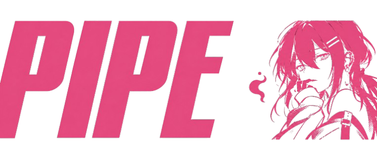

**DIGITAL IDENTITY / PERSONAL PROFILE**

`CHILE` &nbsp; ◈ &nbsp; `INFORMATICS ENGINEERING` &nbsp; ◈ &nbsp; `CREATIVE TECHNOLOGY`

 [Repositories](https://github.com/PipeLev?tab=repositories) · [Kick](https://kick.com/pipelev) · [Twitch](https://www.twitch.tv/pipelev) · [YouTube](https://www.youtube.com/@pipelev)

---

<table>
<tr>
<td width="50%" valign="top">

## 01 / SOBRE MÍ

Hola, soy **Felipe Levican**, conocido como **PipeLev**.

Soy estudiante de primer año de Ingeniería Civil en Informática en Chile. Me interesan la programación, la tecnología, la edición audiovisual y la creación de proyectos personales.

Me gusta experimentar con ideas, aprender nuevas herramientas y mejorar mis habilidades paso a paso.

</td>
<td width="50%" valign="top">

## 01 / ABOUT ME

Hi, I'm **Felipe Levican**, known online as **PipeLev**.

I'm a first-year Civil Engineering in Informatics student from Chile. I'm interested in programming, technology, video editing, and personal projects.

I enjoy experimenting with ideas, learning new tools, and improving my skills step by step.

</td>
</tr>
</table>

  
  
  

---

02 / TECHNICAL ENVIRONMENT

HARDWARE · SOFTWARE · DIGITAL WORKFLOW

LEARN   ◈   EXPERIMENT   ◈   CREATE   ◈   EVOLVE

---

## 03 / PROJECT ARCHIVE

<table>
<tr>
<td width="65%" valign="top">

### Ideas become projects.

**ES** — Mis repositorios reúnen mis proyectos personales, experimentos y trabajos de aprendizaje. Cada uno forma parte de mi proceso de crecimiento.

**EN** — My repositories contain personal projects, experiments, and learning work. Each one is part of my learning journey.

</td>
<td width="35%" valign="middle" align="center">

</td>
</tr>
</table>

---

## 04 / GITHUB ANALYTICS

 

GITHUB DATA SYSTEM · LIVE METRICS · PIPELEV

---
